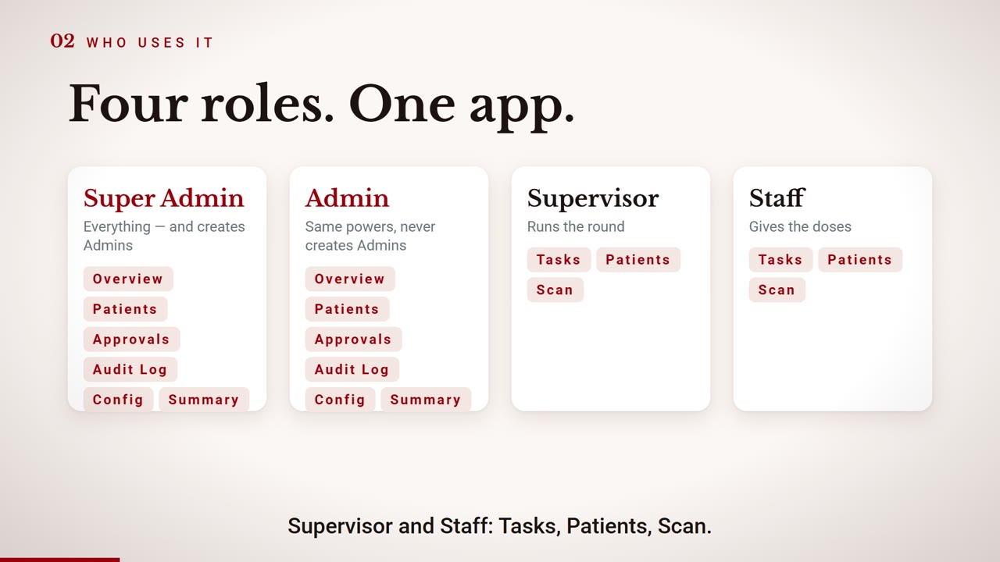
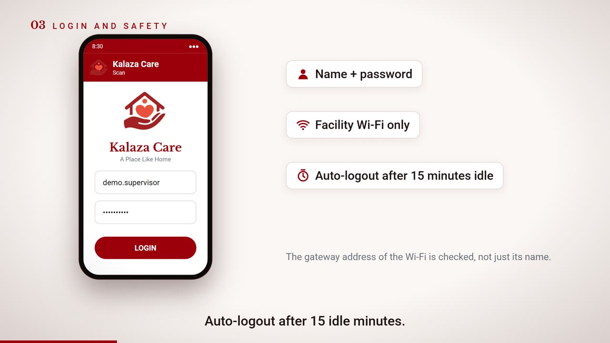
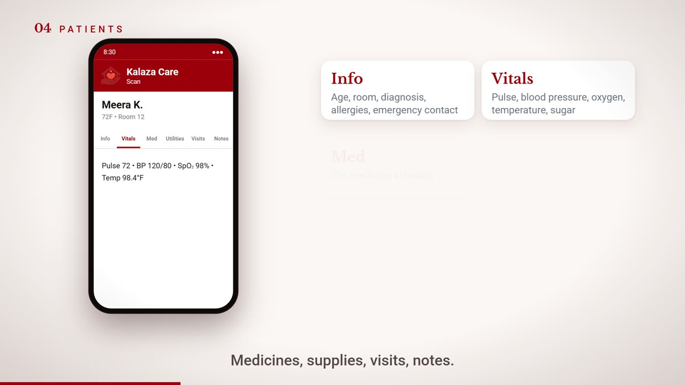
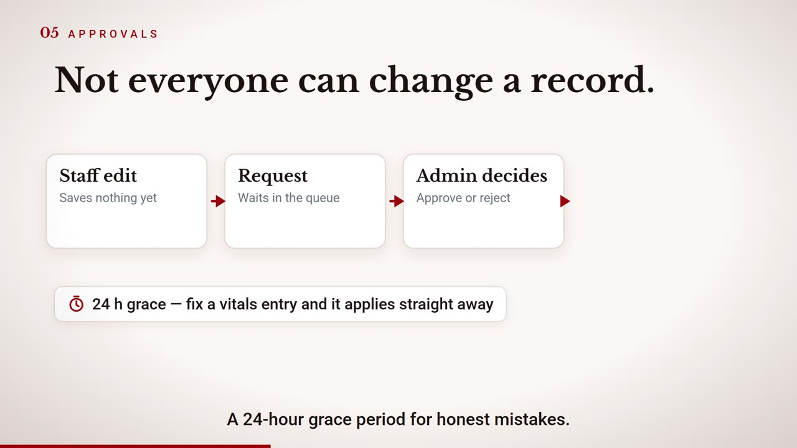
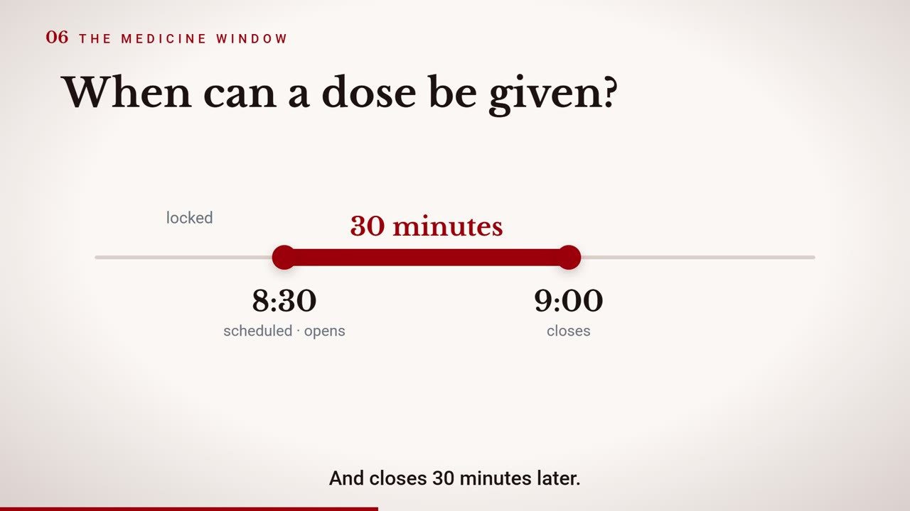
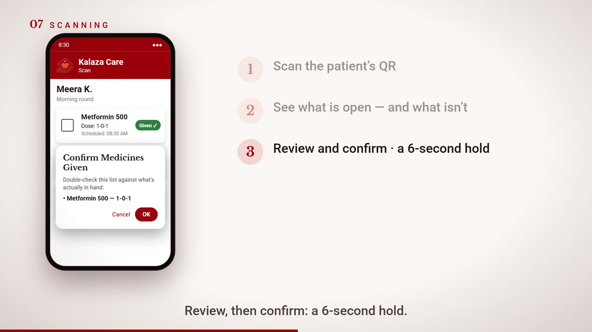
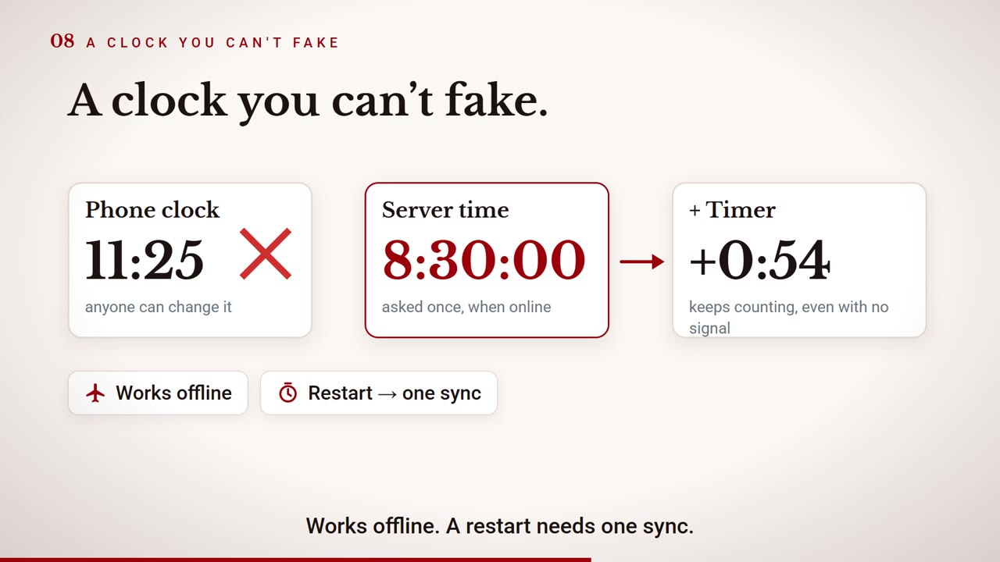
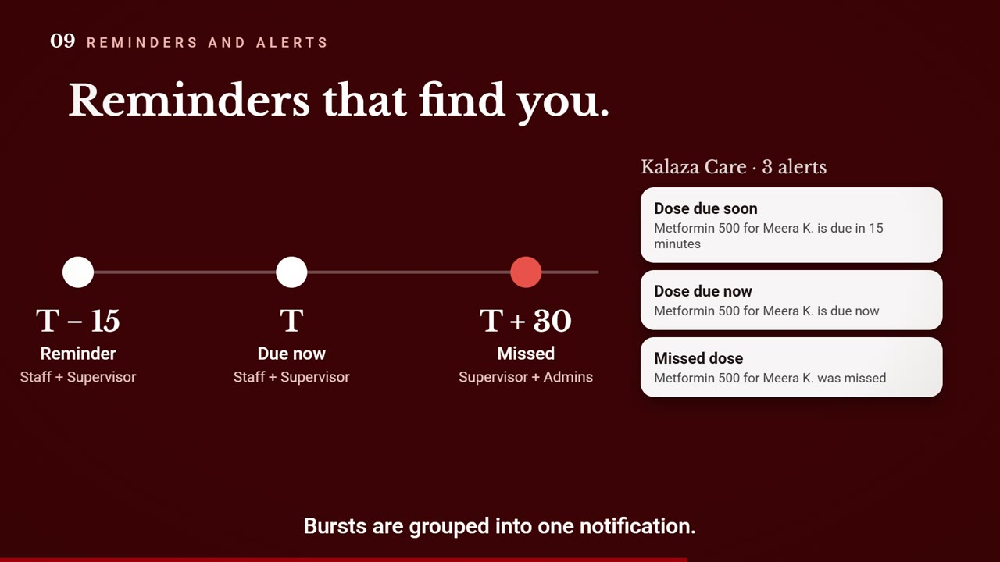
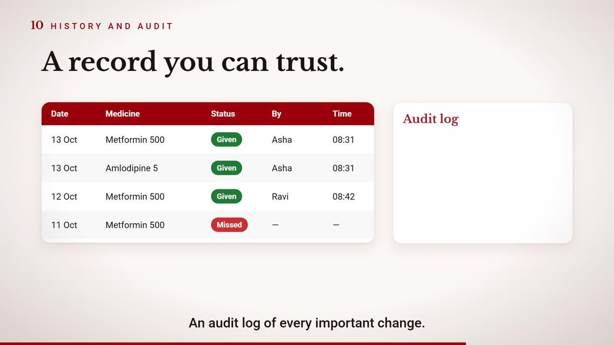
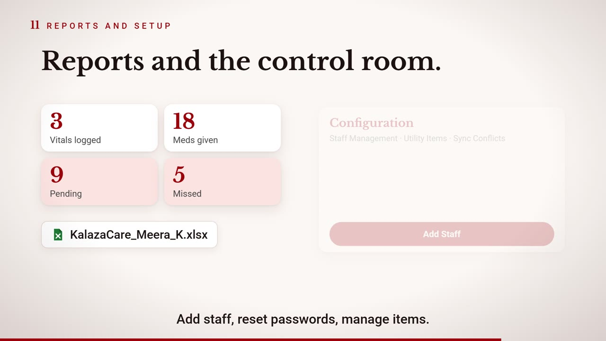

<div align="center">


# Kalaza Care

**Medicine rounds for care homes: every dose scheduled, scanned, timed and accounted for.**

Android · Kotlin · Jetpack Compose · Supabase · Firebase Cloud Messaging

https://github.com/HarshSalunkhe2005/Kalaza-Health-Care-App/blob/main/docs/media/walkthrough.mp4

[Download the 4-minute walkthrough](https://github.com/HarshSalunkhe2005/Kalaza-Health-Care-App/raw/main/docs/media/walkthrough.mp4) · [Download the 22-second teaser](https://github.com/HarshSalunkhe2005/Kalaza-Health-Care-App/raw/main/docs/media/teaser.mp4)

</div>

---

## Why this exists

A residential care home runs on medicine rounds: dozens of residents, several doses a day, a rotating
team. On paper, "was it given, and by whom?" has no reliable answer. Kalaza Care replaces the paper
register with a phone app that makes the correct action the easy one and leaves a trustworthy record
of everything that happens.

> The screens in this README and the videos are re-creations with fictional residents, staff and
> medicines. No real data appears anywhere in this repository.

## What it does

| | |
|---|---|
| **Four roles** | Super Admin, Admin, Supervisor and Staff, each with their own tabs and permissions. Only a Super Admin creates Admins. |
| **Resident profiles** | Basics, vitals, medicines, supplies, doctor visits and notes. Residents are archived, never deleted. |
| **Per-dose windows** | A dose opens at its scheduled time and closes 30 minutes later. Round tags (Morning / Afternoon / Evening) only have to match the QR code. |
| **QR-checked administration** | Scan the resident's QR, review what is due, confirm with a 6-second hold. A closed window is refused at confirm time. Admin overrides still need the right QR. |
| **A clock that cannot be faked** | Server time plus a monotonic timer. Changing the phone's clock changes nothing. Works offline; a restart needs one sync. |
| **Offline first** | A local cache and write queue. Offline ticks are stored with a trusted timestamp, flagged, and replayed; the server verifies them. |
| **Approvals** | Staff edits become requests with a 24-hour grace period. Medicine changes always need approval. |
| **Alerts** | Reminder 15 minutes before, "due now" at the scheduled time, and a missed-dose alert to supervisors and admins when the window closes. Bursts collapse into one notification. |
| **History and audit** | One row per dose per day (given or missed), plus an audit log of every important change. Last 30 days by default. |
| **Reports** | Summaries by date range and per-resident Excel export. |
| **Hardening** | Facility Wi-Fi gate, 15-minute idle auto-logout, screenshot and screen-recording block, row-level security on every table. |

## Screens

<table>
<tr>
<td></td>
<td></td>
</tr>
<tr>
<td></td>
<td></td>
</tr>
<tr>
<td></td>
<td></td>
</tr>
<tr>
<td></td>
<td></td>
</tr>
<tr>
<td></td>
<td></td>
</tr>
</table>

## How a dose is verified

```
        scheduled time T                       T + 30 min
              |<---------- dose window ---------->|
   locked     |   scan QR -> review -> 6 s hold   |   locked / MISSED
              |                                   |
   T - 15 min: reminder to staff + supervisor     |
   T:          "due now"                          |
   T + 30:     missed alert to supervisor + admins
```

1. The app derives "now" from a trusted clock (server time at last sync plus a monotonic timer, invalidated on reboot).
2. A scan is accepted only if the QR payload matches the resident and the dose is inside its window.
3. Confirming re-checks the window. Offline, the tick is queued with its trusted timestamp.
4. A database trigger stamps live ticks with server time and rejects out-of-window writes from non-admins. Replays are accepted only if flagged offline and old enough.
5. A watchdog runs every minute, sending reminders and writing missed-dose records.

## Architecture

```
+---------------------------- Android app -----------------------------+
| Compose UI - ViewModels (StateFlow) - Repositories                   |
|                          |                                           |
|          Room cache + write queue (SyncManager)                      |
|          TrustedClock - connectivity - realtime (debounced)          |
+------------+-----------------------------------------+---------------+
             | supabase-kt                             | FCM data push
     +-------v--------------+  trigger        +--------v-----------+
     | Supabase             +---------------->| Edge Functions     |
     | Postgres + RLS       |                 | send-push,         |
     | guard triggers       |<----------------+ medication-watchdog|
     | pg_cron / pg_net     |                 | admin-reset-pass   |
     +----------------------+                 +--------------------+
```

- **Android:** minSdk 26, Compose Material 3, Navigation-Compose, Room, kotlinx.serialization, CameraX with ML Kit for scanning.
- **Backend:** Supabase Postgres with row-level security and guard triggers for the rules that must not depend on the client, plus Edge Functions (Deno) for push delivery, the minute-by-minute watchdog and admin password resets.
- **Performance:** server-side 30-day filters, paged notifications, debounced realtime refresh, grouped pushes, and indexes on the hot paths.
- **Release:** R8 minification and resource shrinking. The schema, policies and functions live with the Supabase project and are not part of this repository.

## Building

Requirements: Android Studio (or JDK 17 and the Android SDK) and a Supabase project with the Kalaza schema.

1. Copy `local.properties.example` to `local.properties` and fill in `sdk.dir`, `SUPABASE_URL`, `SUPABASE_ANON_KEY` and, optionally, `WIFI_GATEWAY_IPS` (empty disables the Wi-Fi gate).
2. Copy `google-services.json.example` to `app/google-services.json` and replace it with your Firebase config (used for push notifications).
3. Build:

   ```bash
   ./gradlew assembleDebug
   ```

Release builds refuse to start without a Supabase URL. Nothing secret lives in the source tree: configuration is read from the git-ignored `local.properties` into `BuildConfig` at build time.

## Repository layout

```
app/src/main/java/com/kalazacare/app/
  data/       repositories, Room cache, sync queue, Supabase models
  ui/         Compose screens by feature (login, patients, scan, history, ...)
  service/    FCM messaging service
  util/       TrustedClock, DoseQr, Wi-Fi gate, Excel writer, ...
docs/media/   screenshots and videos used in this README
```

## Credits

Built by Harsh Salunkhe, with an initial project scaffold by Eshaan Sumesh.

## License

Copyright (c) 2026 Harsh Salunkhe and contributors. All rights reserved. See [LICENSE](LICENSE).
